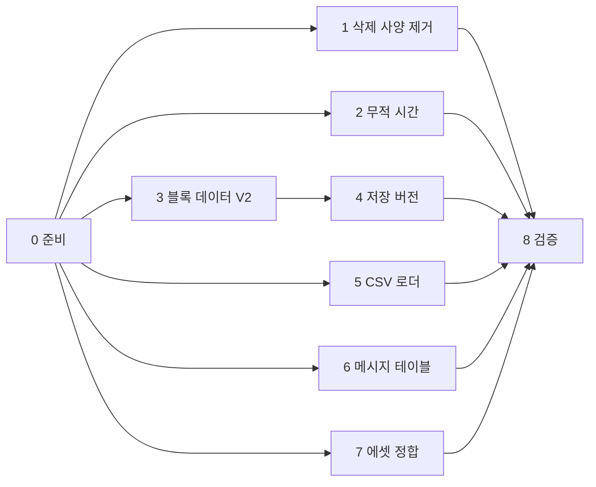

```table-of-contents
```
---
> [!NOTE] 실행 계획 문서입니다.
> [[🗺️ 개발 계획#2. M0. V2 기반 정리]]를 실제로 진행할 순서와 단계별 작업을 정리했습니다. 2026-11-22 기준 `V2_AI_test` 브랜치의 코드를 조사해 작성했습니다.
> 단계를 마치면 [[#1. 진행 순서]] 표의 상태를 고치고, 개발 계획 문서의 작업 상태도 함께 고칩니다.

# 0. 요약
- **목표**: 블록 데이터를 V2 기획(등급 없음, 합·강, 칸당 5점)으로 바꾸고, 기획에서 삭제된 코드를 지우고, 이후 단계가 쓸 공통 기반(CSV 로더, 메시지 테이블)을 만듭니다.
- **순서의 원칙**
	1. 결정 없이 할 수 있는 **작고 독립적인 작업**부터 합니다. 이후 변경의 잡음을 줄입니다.
	2. 가장 큰 작업인 **블록 데이터 V2**는 잘게 나누어, 단계마다 게임이 실행되는 상태를 유지합니다.
	3. **회의 결정이 필요한 작업**(에셋 값 정합, 메시지 문구)은 뒤로 둡니다.
- **조사하며 새로 알게 된 점**
	- 스탯 블록의 스탯 값(`statValue`)은 지금도 블록 점수와 같은 단위(5·10·15)입니다. 그래서 옛 저장 파일을 쉽게 변환할 수 있습니다. → [[#2-5. 4단계 저장 형식 버전 (M0-2)]]
	- 스킬 블록 점수가 칸 수(1~3)에서 칸당 5점(5~15)으로 바뀌면 **스킬 점수 보너스가 약 5배** 커집니다. 기획대로의 변화지만 체감 밸런스가 크게 바뀌므로 테스트 때 확인합니다.
	- 속성 공격력 스탯은 기획이 "블록 점수 1당 3"인데, 코드는 점수를 그대로(1당 1) 씁니다. 3단계에서 맞춥니다.

# 1. 진행 순서
| 단계 | 작업 | 개발 계획 ID | 선행 | 규모 | 상태 |
| --- | --- | --- | --- | --- | --- |
| 0 | 결정 받기·준비 | – | – | S | 대기 |
| 1 | 삭제된 사양 제거 | M0-3 | – | S | 완료 |
| 2 | 피격 무적 시간 | M0-5 | – | S | 완료 |
| 3 | 블록 데이터 V2 | M0-1 | – | L | 진행 |
| 4 | 저장 형식 버전 | M0-2 | 3단계 | S | 대기 |
| 5 | CSV 로더 공통화 | M0-6 | – | M | 대기 |
| 6 | 시스템 메시지 테이블 | M0-7 | 결정 8 | M | 대기 |
| 7 | 기획 값·에셋 값 정합 | M0-4 | 결정 1 | S | 대기 |
| 8 | 검증과 문서 반영 | – | 1~7단계 | S | 대기 |

- "결정 N"은 [[🗺️ 개발 계획#7. 결정이 필요한 사항]]의 번호입니다.
- 1·2·5단계는 3단계와 겹치는 파일이 없어 동시에 진행해도 됩니다.
- 4단계는 3단계가 바꾼 블록 필드를 저장하므로 반드시 3단계 뒤에 합니다.



# 2. 단계별 작업
## 2-1. 0단계 준비
- 회의 또는 담당자에게 받을 결정 ([[#3. 받을 결정]])
	- 결정 1: 에셋 값 차이 15건의 처리. 이 문서에서 15건을 세 묶음으로 나누어 결정할 양을 줄였습니다.
	- 결정 2: 옛 저장 파일 처리. **변환**으로 정했습니다(2026-11-22).
	- 결정 8: 시스템 메시지 키·문구. 정해지지 않으면 6단계는 틀만 만들고 임시 문구를 씁니다.
- 작업 브랜치를 `V2_AI_test`에서 나눕니다. 예: `M0_V2_base`
- 지금 저장 파일(`%USERPROFILE%\AppData\LocalLow\DefaultCompany\ProjectP\save.json`)을 백업해 두고, 4단계 변환 테스트에 씁니다.
- 기존 EditMode 테스트 20개(`StageTests`)가 통과하는지 먼저 확인합니다. 5단계 리팩터링의 기준선이 됩니다.

## 2-2. 1단계 삭제된 사양 제거 (M0-3)
- 몬스터 원거리 공격을 지웁니다.
	- 스크립트: `EnemyRangedAttack.cs`, `EnemyBullet.cs`
	- 에셋·프리팹: `Bullet_Enemy.asset`, `EnemyBullet 1.prefab`, `Enemy 2.prefab`의 `EnemyRangedAttack` 컴포넌트
	- 참조: `RoundManager`의 `EnemyBullet.DespawnAll()` 두 곳, `PhysicsLayerSetup`의 `EnemyBullet` 레이어 설정
- 몬스터 골드를 지웁니다.
	- `EnemyData`의 `baseGold`·`goldMultiplier`·`GetGold`, `Enemy.Gold`, `EnemyEditor`의 골드 표시
- 주의
	- 스크립트를 지우기 전에 Unity 에디터에서 프리팹의 컴포넌트를 먼저 빼야 "Missing Script"가 남지 않습니다.
	- 프로젝트 설정의 `EnemyBullet` 물리 레이어는 남겨도 동작에 지장이 없습니다. 지울지는 선택입니다.
- 확인: Game 씬에서 1스테이지를 진행해 삼각형 몬스터가 탄환을 쏘지 않고, 콘솔 오류가 없는지 봅니다.
- 문서: [[스탯 문서 분리 계획#6. 기획 값과 현재 에셋 값의 차이]]의 10번(골드)·15번(원거리 탄환)이 해소됩니다.

## 2-3. 2단계 피격 무적 시간 (M0-5)
- 플레이어가 대미지를 입으면 0.3초 동안 추가 대미지를 받지 않게 합니다.
	- `Unit`에 `IsInvulnerable` 훅을 두고, `Player`가 피격 시각으로 무적 여부를 판단합니다. 무적 중이면 `TakeDamage`가 0을 돌려줍니다.
	- 무적 시간은 `Player` 컴포넌트의 직렬화 필드 `invulnerableDuration`으로 둡니다(코드 상수 금지).
- 몬스터 쪽 영향
	- `Enemy`의 근접 공격은 대미지와 관계없이 쿨타임을 먼저 다시 채웁니다. 대미지가 0보다 클 때만 일어나는 것은 넉백입니다.
	- 무적 중의 공격은 빗나간 것으로 처리합니다(A안, 2026-11-22 결정). 막힌 몬스터는 넉백되지 않고 쿨타임 뒤에 다시 때립니다. 몬스터 코드는 바꾸지 않습니다.
- 깜빡임 연출(`blinkDuration` 2초)과 무적 시간(0.3초)은 별개로 둡니다.
- 문서: [[📊 플레이어 스탯#2-6. 무적 시간]]의 확인 필요 콜아웃을 지우고, 조절 위치를 적습니다.

## 2-4. 3단계 블록 데이터 V2 (M0-1)
- 가장 큰 작업이라 여섯 개로 나눕니다. 각 작은 단계가 끝날 때마다 게임이 실행되어야 합니다.
- 2026-11-22 결정: 속성 공격력 계수는 기획대로 3으로 하고, 블록 점수 저장은 3-2에서 시작하고, 스킬 점수 보너스가 약 5배 커지는 것은 기획대로 받아들입니다.

| 순서 | 작업 | 주요 파일 | 상태 |
| --- | --- | --- | --- |
| 3-1 | 점수 계산 함수 분리와 테스트 | 신규 `BlockScore` | 완료 |
| 3-2 | 블록에 점수·강 필드 추가 | `Block`, `BlockManager` | 완료 |
| 3-3 | 스탯 값을 점수에서 계산 | `BlockStatData`, `BlockStatTotals` | 완료 |
| 3-4 | 스킬 점수를 블록 점수로 통일 | `SkillManager`, `Block` | 완료 |
| 3-5 | 등급 제거, 최대 3합 | `Block`, `MergeResultSlot` | 대기 |
| 3-6 | 에디터·에셋 정리 | `BlockSettings`, 에셋 | 대기 |

### 3-1. 점수 계산 함수 분리와 테스트
- `Block`은 MonoBehaviour라 테스트하기 어렵습니다. 규칙을 순수 함수로 모은 `BlockScore`(정적 클래스)를 만듭니다.
	- 원본 블록 점수 = 칸 수 × 5: `FromCells`
	- 병합 결과 점수 = 메인 블록 점수 + 소모 블록 점수: 단순 덧셈이라 함수로 두지 않습니다.
	- 강화 점수 = 원본 점수 × (1 + 0.2 × 강): `Enhance`. 원본 점수는 3합 0강 상태의 점수이고, 소수점 아래는 버립니다.
	- 남은 병합 횟수 = 3 − 합: `GetRemainingMerges`
- 칸당 점수(5), 최대 합(3), 1강당 증가율(20%)은 `BlockSettings` 에셋 필드(`scorePerCell`, `maxMergeCount`, `enhanceRatePercent`)로 둡니다.
- 확인은 EditMode 테스트 대신 임시 로그 `BackpackDebugLog`로 합니다. 가방 배치가 바뀔 때마다 가방의 모든 블록 정보와 V2 규칙으로 계산한 점수를 콘솔에 남깁니다. 3단계를 마치면 지웁니다.
- 기획: [[🧱 블록#4. 블록 점수]], [[🧱 블록 강화#4. 블록 강화 결과]]

### 3-2. 블록에 점수·강 필드 추가
- `Block`에 점수 필드 세 개를 추가합니다.
	- `baseScore`: 강화하지 않은 원본 점수. 기획의 "원본 점수(3합 0강)"와 같습니다.
	- `enhanceLevel`: 강
	- `score`: 최종 점수 = `baseScore` × (1 + 0.2 × 강)
	- 세 값은 `Block.SetScore(원본, 강, 1강당 %)` 하나로만 정합니다. 블록은 설정 에셋을 모르므로, 1강당 증가율은 `BlockManager`가 `BlockSettings`에서 넘겨줍니다.
- 드롭 블록은 `BlockScore`로 원본 점수를 정하고, 병합 블록은 두 블록의 원본 점수를 더합니다. 병합한 뒤에는 메인 블록이 원래 몇 점이었는지 남기지 않습니다(2026-11-23 결정).
- 점수를 블록에 넣는 순간부터 저장해야 불러온 블록의 점수가 0이 되지 않습니다. 그래서 `BlockSaveData`에 `baseScore`·`enhanceLevel`을 이 단계에서 추가합니다. 최종 점수는 저장하지 않고 불러올 때 다시 계산합니다.
	- 옛 저장 파일은 이 값이 0으로 읽히므로 바꿔 읽습니다(결정 2: 변환). 스탯 블록 점수 = 옛 `statValue`, 스킬 블록 점수 = 옛 `skillScore` × 5
- 이 단계에서는 기존 `stat.value`, `skillScore`를 아직 지우지 않습니다. 다음 단계에서 하나씩 옮겨 갑니다.

### 3-3. 스탯 값을 점수에서 계산
- 스탯 블록의 스탯 값 = 블록 점수 × 스탯별 계수
	- 계수는 기획 값을 따릅니다. 속성 공격력은 3, 나머지(HP, 회복 증가, 방어력, 공격력, 대미지 증가, 쿨타임 감소, 스킬 지속 시간·범위 증가)는 1입니다.
- `BlockStatData`를 "스탯 × 블록 번호 점수 표"에서 "스탯별 점수 1당 수치(`valuesPerScore`) 표"로 바꿉니다. `BlockStatDataEditor`도 "스탯 | 점수 1당 수치" 표로 바꿉니다.
	- 목록 필드 이름을 `rows`에서 `valuesPerScore`로 바꿉니다. 같은 이름이면 에디터가 켜진 채 다시 컴파일될 때 옛 행이 계수 0으로 읽힙니다.
	- 에셋에 행이 없으면 코드의 기본 계수(속성 공격력 3, 나머지 1)로 계산합니다. 그래서 에셋을 다시 저장하기 전에도 값이 맞습니다.
- `BlockStat`은 스탯 종류만 가집니다. `value`와 `Merge`를 지웠습니다.
- `BlockStatTotals`가 블록마다 "블록 점수 × 계수"를 계산해 합산합니다. 계수 표는 `SkillManager`가 `BlockManager`의 블록 설정에서 가져오므로 씬은 고치지 않았습니다.
- 드롭할 때는 스탯 종류만 고르고, 병합 결과는 메인 블록의 스탯 종류를 따릅니다. `BlockSaveData.statValue`는 새로 쓰지 않고, 옛 저장 파일을 변환할 때만 읽습니다.
- 2026-11-23 결정
	- 계수는 정수입니다. 기획 계수가 모두 정수라 점수 계산과 같은 정수 계산을 씁니다.
	- 계수에 곱하는 점수는 강화가 반영된 최종 점수(`Score`)입니다.
	- 수치는 블록에 저장하지 않고 합산할 때 계산합니다. 계수를 고치면 가지고 있는 블록에도 바로 적용됩니다.
	- 35 스탯 문서의 조절 위치(`BlockStatData`의 계수)는 8단계를 기다리지 않고 이 단계에서 적었습니다.
- 바뀐 수치: 속성 공격력만 3배가 됩니다(3칸 블록 15 → 45). 나머지 스탯 값은 전과 같습니다.
- 기획: [[📊 플레이어 스탯]], [[📊 스킬 스탯#2. 공유 스탯]]

### 3-4. 스킬 점수를 블록 점수로 통일
- `Block.skillScore`를 지우고, `SkillManager`가 스킬 블록의 `Score`를 쓰게 합니다.
	- 스킬 점수 = 가방에 놓인 같은 스킬·속성 블록의 블록 점수 합
	- `Block.SetSkill`, `Block.Build`, `BlockManager.CreateMergedBlock`에서 스킬 점수 인자를 지웠습니다. 병합 결과의 점수는 3-2의 원본 점수 합으로 정해집니다.
	- `BlockSaveData.skillScore`는 새로 쓰지 않고, 옛 저장 파일을 변환할 때만 읽습니다.
- 2026-11-23 결정: 스킬 점수도 3-3의 스탯처럼 강화가 반영된 최종 점수(`Score`)를 씁니다.
- 점수가 칸 수에서 칸당 5점으로 바뀌어 스킬 점수 보너스가 약 5배 커집니다. 예: 3칸 탄환 블록이 3점(보너스 0회)에서 15점(보너스 1회)이 됩니다.
	- 탄환의 3번째 보너스(탄환 개수 +1)가 3칸 + 3칸 병합 블록 하나(30점)로 닿습니다. 이 보너스를 유지할지는 회의 안건 1에 남아 있어, 8단계 체감 메모에 함께 적습니다.
- 기획: [[📊 스킬 점수]]

### 3-5. 등급 제거, 최대 3합
- `Block`의 `grade`, `SetGrade`, `Grade`를 지우고, `RemainingMerges`를 `BlockScore`의 "3 − 합"으로 바꿉니다.
- `MergeResultSlot`의 등급 일치 검사와 `SYSTEM_MERGE_NOT_SYNC_GRADE` 메시지를 지웁니다.
- `BlockManager.CreateMergedBlock`, `Block.Build`의 등급 인자를 지웁니다.
- 이 단계에서는 등급만 지웁니다. "스킬 블록은 속성만 같으면 병합", 큐브 비용 같은 나머지 병합 규칙은 M1-7에서 합니다.

### 3-6. 에디터·에셋 정리
- `BlockSettings.dropGrade`를 지웁니다. `BlockStatDataEditor`는 3-3에서 새 계수 표에 맞췄습니다.
- 블록 프리팹 9개와 `BlockSettings.asset`에 남은 `grade` 값, 프리팹의 `stat.value`, `BlockStatData.asset`의 옛 `blockCount`·`rows`는 Unity가 다음 저장 때 지웁니다. 남아 있어도 동작에는 지장이 없습니다.
- 확인
	- 새 저장으로 시작해 블록을 드롭하고, 인스펙터에서 점수가 칸당 5점인지 봅니다.
	- 같은 블록을 3번까지 병합할 수 있고, 4번째는 막히는지 봅니다.
	- 가방에 스탯 블록을 놓아 스탯 UI(`SkillStatusView`)의 값이 "점수 × 계수"인지 봅니다.
- 확인이 끝나면 임시 로그 `BackpackDebugLog`를 지웁니다.

## 2-5. 4단계 저장 형식 버전 (M0-2)
- `SaveData`에 `version` 필드를 넣습니다. 버전이 없는 옛 파일은 버전 0으로 봅니다.
- 변환 규칙 (결정 2: 변환, 2026-11-22). 3-2단계에서 점수가 0일 때 바꿔 읽는 방식으로 먼저 넣고, 여기서 버전 0일 때만 적용하도록 옮깁니다.
	- 스탯 블록: 점수 = 옛 `statValue` (지금도 점수와 같은 단위)
	- 스킬 블록: 점수 = 옛 `skillScore` × 5 (옛 값은 칸 수의 합)
	- 합 = 옛 `mergeCount`, 강 = 0, `grade`는 버림
- `BlockSaveData`의 `grade`·`statValue`·`skillScore`는 읽기 전용으로만 남기고, 새로 쓸 때는 `baseScore`·`enhanceLevel`을 씁니다.
- 확인: 0단계에서 백업한 옛 저장 파일로 시작해 블록이 그대로 있고, 점수가 규칙대로 바뀌었는지 봅니다. 변환 함수는 EditMode 테스트로 고정합니다.

## 2-6. 5단계 CSV 로더 공통화 (M0-6)
- `StageTable`에서 공통 부분을 떼어 `CsvTable`(가칭)로 옮깁니다.
	- 줄 나누기(CRLF, 빈 줄, `#` 주석 무시), 머리글 이름으로 열 찾기, 셀 정수·실수 변환, 오류·경고 목록
- `StageTable`은 `CsvTable`을 써서 스테이지 규칙(라운드 10 검사, 오각형 최대 수 등)만 남깁니다.
- 확인: 기존 `StageTests` 20개가 그대로 통과해야 합니다. `CsvTable` 자체의 테스트도 추가합니다.
- 이 로더는 M1-2(해금 순서표), M2-1(가방 레벨 CSV), M3-7(대미지 계수 CSV)에서 씁니다.

## 2-7. 6단계 시스템 메시지 테이블 (M0-7)
- 로케일 키 → 문구 테이블을 만들고, 코드는 키로만 문구를 찾게 합니다.
	- 형식 추천: `Assets/Data`에 CSV(키, 한국어, 이후 언어 열 추가). UXUI 폴더의 `InGame_SYSTEM_LOCALE_Exported_Locales.xlsx`를 CSV로 내보내 쓸 수 있는지 먼저 확인합니다.
	- 키가 없으면 키 문자열을 그대로 보여주고 경고를 남깁니다.
- `MergeResultSlot`의 코드 상수 메시지를 옮깁니다.
	- 기획에 있는 키: `SYSTEM_MERGE_NO_ATTACH_BLOCK`, `SYSTEM_MERGE_DIFFERENT_CORE`
	- 기획에 없는 키(`SYSTEM_MERGE_NOT_SYNC_STAT`·`_SKILL`, 원본 블록, 남은 횟수): 결정 8이 나기 전까지 임시 키로 두고, [[💬 시스템 메시지]]에 "임시"로 등록합니다.
- 기획: [[💬 시스템 메시지]]

## 2-8. 7단계 기획 값·에셋 값 정합 (M0-4)
- [[스탯 문서 분리 계획#6. 기획 값과 현재 에셋 값의 차이]]의 15건을 아래처럼 나누면 회의에서 정할 것이 4건으로 줄어듭니다.

| 묶음 | 번호 | 처리 |
| --- | --- | --- |
| 삭제된 사양 | 10, 15 | 1단계에서 코드와 함께 제거 |
| 기획 값 없음 | 4~9, 12~14 | 에셋 값을 기획 값으로 채택 (제안) |
| 값이 서로 다름 | 1, 2, 3, 11 | 회의에서 결정 |

- "기획 값 없음" 9건: 지금 에셋 값을 스탯 문서의 기획 값 칸에 적는 안입니다. 테스트하며 이미 써 온 값이라 그대로 확정해도 무리가 적습니다.
- "값이 서로 다름" 4건
	- 1번 라운드 생성 시간: 기획 100초, 에셋 20초
	- 2번 탄환 관통력: 기획 1, 에셋 0
	- 3번 공격 지대 지름: 기획 20, 에셋 2 (단위 차이일 수 있음)
	- 11번 오각형 이동 속도: 기획 문서 안에서 상대 비교(↑)와 수치(0.2, 가장 느림)가 서로 충돌
- 결정이 나면 에셋을 고치고, 스탯 문서의 확인 필요 콜아웃을 지웁니다.

## 2-9. 8단계 검증과 문서 반영
- 테스트
	- EditMode 테스트 전부 통과: 기존 `StageTests` + 4단계 저장 변환 + 5단계 CSV
- 플레이 확인 (Game 씬, 새 저장)
	- 1~2스테이지를 진행하며 콘솔 오류가 없는지
	- 드롭 블록 점수, 3합 병합, 스탯 반영, 무적 시간
	- 스킬 점수 보너스가 커진 뒤의 체감 난이도 (메모를 남겨 회의 안건으로)
- 문서
	- [[🗺️ 개발 계획]]의 M0 작업 상태를 "완료"로, 1장 현재 구현 현황의 블록·병합·저장 항목을 고칩니다.
	- 35 스탯 문서의 "조절 위치" 열에 새로 생긴 위치(`BlockSettings`의 점수 규칙, `Player`의 무적 시간)를 적습니다. `BlockStatData`의 계수는 3-3에서 적었습니다.

# 3. 받을 결정
| 결정 | 내용 | 추천 |
| --- | --- | --- |
| 1 | 에셋 값 차이 15건 | 9건은 에셋 값 채택, 4건만 회의 |
| 2 | 옛 저장 파일 처리 | 변환 (결정됨) |
| 8 | 시스템 메시지 키·문구 | 우선 임시 키로 진행 |

- 결정 1은 [[#2-8. 7단계 기획 값·에셋 값 정합 (M0-4)]]의 묶음을 보고 정합니다.
- 결정 2의 근거: 변환 규칙이 단순하고([[#2-5. 4단계 저장 형식 버전 (M0-2)]]), 테스트하며 만든 블록을 잃지 않습니다.

## 3-1. M0에서 함께 확인할 점
- **병합 칸의 블록 겹침**: 병합 칸 두 개는 같은 3×3 좌표를 쓰는데, 코드에서 두 블록이 같은 칸에 겹치는지 검사하는 부분을 찾지 못했습니다. 겹치면 결과 블록의 칸 수는 줄고 점수는 그대로 더해질 수 있습니다. 기획상 겹침이 허용되는지 확인하고, 불가라면 M1-7에서 막습니다.
- **스킬 점수 보너스 5배**: [[#3-4. 스킬 점수를 블록 점수로 통일]]의 변화가 너무 크면 [[📊 스킬 점수]]의 보너스 간격(10점)을 조정할지 회의 안건으로 올립니다.

# 4. 커밋 계획
- 커밋은 직접 합니다. 아래는 단계별 제안입니다. 기획 문서 변경은 코드와 커밋을 나눕니다.

| 단계 | 커밋 메시지 (제안) |
| --- | --- |
| 1 | `[몬스터] 기획에서 삭제된 원거리 공격과 골드 제거` |
| 2 | `[플레이어] 피격 후 무적 시간 추가` |
| 3-1 | `[블록] 블록 점수 규칙을 BlockScore로 분리하고 테스트 추가` |
| 3-2 | `[블록] 블록에 점수와 강화 수치 필드 추가` |
| 3-3 | `[스탯] 스탯 블록의 스탯 값을 점수 × 스탯별 계수로 계산` |
| 3-4 | `[스킬] 스킬 점수를 블록 점수로 통일` |
| 3-5 | `[블록] 등급을 제거하고 최대 병합 횟수를 3회로 변경` |
| 3-6 | `[블록] 등급 관련 에디터와 에셋 설정 정리` |
| 4 | `[저장] 저장 형식 버전과 옛 블록 데이터 변환 추가` |
| 5 | `[데이터] CSV 파싱을 공통 로더로 분리` |
| 6 | `[UI] 시스템 메시지를 로케일 키 테이블로 이동` |
| 7 | `[데이터] 기획 값에 맞춰 설정 에셋 수치 조정` |
| 8 | `[문서] M0 완료에 맞춰 개발 계획과 스탯 문서 갱신` |

# 변경 이력
- 2026-11-22: 문서 작성
