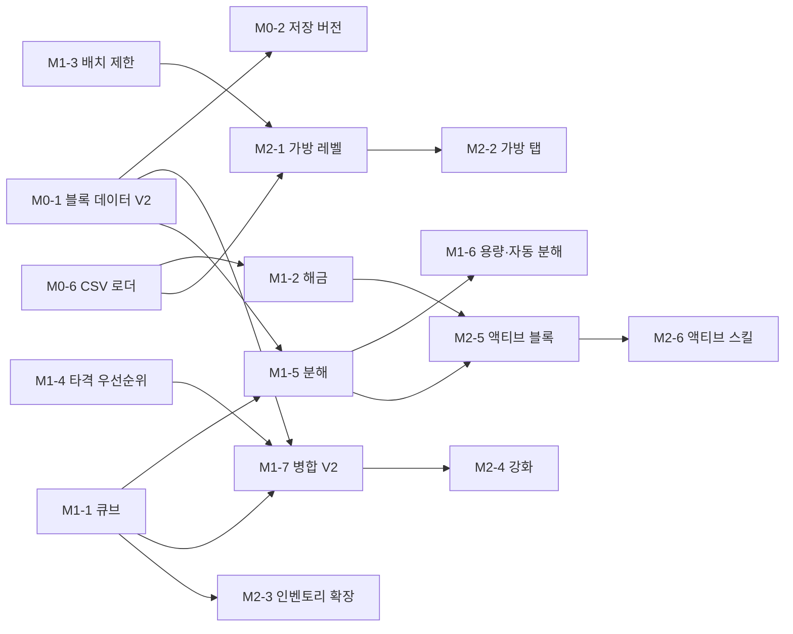

```table-of-contents
```
---
> [!NOTE] 개발 계획 문서입니다.
> 기획 문서(V2, 2026-11-18 회의·2026-11-19 결정 반영)와 `V2_AI_test` 브랜치의 Unity 코드를 2026-11-22에 대조해 작성했습니다.
> 작업을 시작하거나 마치면 각 단계의 "작업 목록" 표에서 상태 열을 고칩니다. 기획이 바뀌면 기획 문서를 먼저 고치고 이 문서를 맞춥니다.

# 0. 요약
- **현재 위치**: 전투 프로토타입은 돌아갑니다. 스테이지·라운드 진행, 몬스터 4종, 공격 스킬 3종(탄환·광역 탄환·지원), 속성 7종, 가방·인벤토리 배치, 블록 병합, 자동 저장이 구현되어 있습니다.
- **핵심 문제**: 2026-11-18 회의 이후의 V2 기획이 코드에 거의 반영되지 않았습니다.
	- 블록은 아직 **등급(grade)** 으로 병합 횟수를 계산합니다. 그래서 지금은 모든 블록이 **한 번만** 병합됩니다. V2는 등급 없이 "합(최대 3)·강"입니다.
	- 순환의 축인 **큐브·블록 분해·자동 분해**가 없어, 블록이 쌓이기만 하고 쓸 곳이 없습니다.
	- **블록 해금, 타격 우선순위, 가방 레벨·여러 가방, 인벤토리 용량, 액티브 스킬, 블록 강화**가 없습니다.
- **계획**: 다섯 단계로 나누어 진행합니다. 앞 단계가 뒤 단계의 데이터 구조를 정하므로 순서대로 갑니다.

| 단계 | 이름 | 끝나면 할 수 있는 것 |
| --- | --- | --- |
| M0 | V2 기반 정리 | 기획 문서의 구조·수치로 테스트 |
| M1 | 핵심 루프 | 드롭 → 분해·큐브 → 병합 한 바퀴 |
| M2 | 성장 확장 | 큐브 소모처 전부, 보스 보상 |
| M3 | 전투 다양화 | 유형별 몬스터 움직임, 블록 외형 |
| M4 | 데모 준비 | 외부 테스트용 Windows 빌드 |

- 각 단계의 목표는 해당 장의 첫 절에 있습니다.
- 각 단계를 시작하기 전에 정해야 할 기획 사항은 [[#7. 결정이 필요한 사항]]에 모았습니다. 특히 M1 전에 **해금 순서표**와 **큐브 균형**이 정해져야 합니다.
- 일정(날짜)은 팀의 주당 작업 시간이 정해지면 [[#8. 일정]]에 적습니다. 지금은 작업마다 규모만 표시했습니다.

# 1. 현재 구현 현황
- 2026-11-22 기준, 기획 문서와 코드(`ProjectP/Assets/Scripts`)를 대조한 결과입니다.
- 상태: ✅ 기획대로 구현 / 🟡 일부 구현 또는 기획과 다름 / ❌ 미구현

## 1-1. 한눈에 보기
| 분류 | 문서·영역 | 상태 | 요약 |
| --- | --- | --- | --- |
| 진행 | [[🏰 스테이지]] | 🟡 | 라운드 진행 완료, 해금·보스 보상 없음 |
| 진행 | [[👿 몬스터]] | 🟡 | 직선 이동만, 삭제된 원거리 공격 남음 |
| 블록 | [[🧱 블록]] | 🟡 | 등급 남음, 점수 체계 두 갈래 |
| 블록 | [[🧱 블록 병합]] | 🟡 | 1회만 병합됨, 큐브 비용 없음 |
| 블록 | [[🧱 블록 분해]] | ❌ | 없음 |
| 블록 | [[🧱 블록 강화]] | ❌ | 없음 (기획 초안) |
| 블록 | [[💎 큐브]] | ❌ | 없음 |
| 블록 | [[📦 가방]] | 🟡 | 4×4 고정, 배치 제한 없음 |
| 블록 | [[🎒 인벤토리]] | 🟡 | 용량 제한 없음 |
| 능력 | [[⚔️ 스킬]] | 🟡 | 3종 구현, 타격은 가까운 적만 |
| 능력 | [[⚡ 속성]] | ✅ | 7종 효과 구현 |
| 능력 | [[✨ 액티브 스킬]] | ❌ | 없음 |
| 능력 | 35 스탯 문서 | 🟡 | 에셋 값 차이 15건, 무적 시간 없음 |
| 공통 | 저장 | 🟡 | 큐브·해금·가방 레벨 필드 없음 |
| 공통 | UI | 🟡 | 분해·강화·가방 탭 화면 없음 |
| 공통 | 데이터 | 🟡 | 스테이지 CSV만 있음 |
| 공통 | 테스트 | 🟡 | 스테이지 테스트 20개만 있음 |

## 1-2. 진행
- **[[🏰 스테이지]]** 🟡
	- 구현
		- 스테이지 CSV 파서(`StageTable`). 머리글 이름으로 열을 연결하고 오류·경고를 검사합니다.
		- 소환 순서(`SpawnSequence`), 승리·패배 시 라운드 이동, 라운드 종료 자동 저장
		- 보스 최초 처치 이벤트(`RoundManager.BossFirstCleared`)
		- EditMode 테스트 20개(`StageTests`)
	- 기획과 다름 · 빠짐
		- **블록 해금이 없습니다.**
		- 보스 최초 처치 이벤트는 있지만 보상이 없습니다.
		- `StageTable.csv`는 2스테이지(20줄)까지만 있습니다.
		- 라운드 생성 시간이 에셋 20초, 기획 100초입니다.
- **[[👿 몬스터]]** 🟡
	- 구현
		- 4종 데이터(`EnemyData 1~4`), 오브젝트 풀, 근접 접촉 공격, 사망 조각 파티클
	- 기획과 다름 · 빠짐
		- 모든 유형이 **직선 이동만** 합니다(`Enemy` · `MoveTowards`). 삼각형 대각선 이동, 사각형 범위 버프가 없습니다.
		- **기획에서 삭제된 원거리 공격**(`EnemyRangedAttack`, `EnemyBullet`, `Bullet_Enemy.asset`)과 골드(`baseGold`)가 남아 있습니다.

## 1-3. 블록
- **[[🧱 블록]]** 🟡
	- 구현
		- 1~3칸 블록 9종 프리팹, 코어 8종(스탯 1 + 속성 7)
		- 스탯 블록 점수 표(`BlockStatData`)
		- 드롭 확률(`BlockDropper`, Game 씬 80%)
	- 기획과 다름 · 빠짐
		- **등급(`grade`)이 남아 있습니다.**
		- 블록 점수가 두 갈래입니다. 스탯 블록은 `BlockStatData` 표, 스킬 블록은 칸 수(1~3점)를 씁니다. 기획은 칸당 5점입니다.
		- 해금과 무관하게 코어 8종을 균등하게 뽑습니다.
		- 4·5칸 블록과 타격 우선순위 옵션이 없습니다.
		- 스탯 블록은 모두 흰색이고, 아이콘·점수 표시가 없습니다.
- **[[🧱 블록 병합]]** 🟡
	- 구현
		- 병합 칸 2개와 결과 미리보기, 인접 검사, 소모 블록은 원본만, 병합 버튼
	- 기획과 다름 · 빠짐
		- **등급 일치 검사**와 **남은 횟수 = 등급 − 병합 횟수** 검사가 남아 1회만 병합됩니다. V2는 최대 3합입니다.
		- 스킬 블록은 **스킬까지 같아야** 병합됩니다. V2는 속성만 같으면 됩니다.
		- **큐브 비용이 없습니다.**
		- 메시지가 로케일 키 없이 코드 상수(`SYSTEM_MERGE_NOT_SYNC_*`)입니다.
		- 결과를 버튼으로 가져갑니다. 기획은 결과 칸 클릭·드래그입니다.
- **[[🧱 블록 분해]]** ❌
	- 수동 분해, 자동 분해, 다중 선택, 필터가 모두 없습니다.
- **[[🧱 블록 강화]]** ❌
	- 기획이 초안 상태입니다.
- **[[💎 큐브]]** ❌
	- 재화 자체가 없습니다.
- **[[📦 가방]]** 🟡
	- 구현
		- 그리드 배치·해제(드래그), 겹침 방지, 전투 중 배치 변경
		- 배치 변경 시 스탯 재계산(`Backpack.BlocksChanged` → `SkillManager`)
		- 스탯·스킬 상태 UI(`SkillStatusView`)
	- 기획과 다름 · 빠짐
		- Game 씬 가방이 **4×4 고정**입니다. 기획은 기본 3×3 + 가방 레벨 CSV입니다.
		- **같은 스킬·속성 블록은 하나만 배치**하는 제한이 없습니다.
		- 가방 레벨업, 여러 가방, 탭이 없습니다.
- **[[🎒 인벤토리]]** 🟡
	- 구현
		- 4열 스크롤 목록(`Storage`), 블록 크기별 표시 배율
	- 기획과 다름 · 빠짐
		- **용량 제한이 없습니다.** 기획은 기본 50칸입니다.
		- 보유 개수 표시, 확장 버튼, 가득 찬 뒤 자동 분해가 없습니다.

## 1-4. 능력
- **[[⚔️ 스킬]]** 🟡
	- 구현
		- 무속성 탄환, 탄환, 광역 탄환과 공격 지대, 지원 크리쳐
		- (스킬, 속성)마다 쿨타임이 따로 흐릅니다(`BulletShooter`·`SupportShooter`의 `Lane`).
		- 스킬 점수 보너스(코드 상수)
	- 기획과 다름 · 빠짐
		- **타격 우선순위는 가까운 적만** 있습니다.
		- 발사 수는 에셋의 동시 발사 개수 + 점수 보너스로 정해집니다. "블록 하나당 탄환 하나"는 가방 배치 제한이 생기면 자연히 맞춰집니다([[#M1-3. 가방 배치 제한]]).
- **[[⚡ 속성]]** ✅
	- 구현
		- 7종 효과 전부(`ElementSettings`, `EnemyElementStatus`), 속성 주입, 폭발 범위 연출
	- 기획과 다름 · 빠짐
		- 빨강 폭발 범위가 기획 미정입니다(에셋 1.5).
- **[[✨ 액티브 스킬]]** ❌
	- 체력 회복 함수(`Unit.Heal`, 회복 증가 적용)만 있습니다.
	- 액티브 블록, 회복·폭탄, 쿨타임이 모두 없습니다.
- **35 스탯 문서** 🟡
	- 구현
		- 플레이어 HP·회복 증가·방어력
		- 블록 스탯 합산(`BlockStatTotals`), 쿨타임 감소 상위 20개 곱 적용, 대미지 공식
	- 기획과 다름 · 빠짐
		- 기획 값과 에셋 값이 다른 곳이 15건입니다. → [[스탯 문서 분리 계획#6. 기획 값과 현재 에셋 값의 차이]]
		- 피격 무적 0.3초가 없습니다. → [[📊 플레이어 스탯#2-6. 무적 시간]]

## 1-5. 공통
- **저장** 🟡
	- 구현: `save.json`(임시 파일에 쓴 뒤 교체), 진행 라운드, 보스 처치 스테이지, 블록과 가방 배치
	- 빠짐
		- 큐브, 인벤토리 용량, 가방 레벨, 해금 상태 필드
		- 저장 형식 버전 번호 (등급을 없앨 때 옛 저장 파일 처리에 필요)
- **UI** 🟡
	- 구현: Main 씬(시작·설정·종료), Game 씬의 인벤토리·가방·병합 패널 전환, 라운드 표시, ESC 일시정지, 한국어 폰트(Static 아틀라스)
	- 빠짐
		- 분해·강화 화면, 큐브 표시, 가방 탭, 인벤토리 개수·확장 버튼
		- Canvas는 1920×1080 기준이지만 UXUI pptm 시안은 1080×1080 기준이라 되돌려야 합니다.
- **데이터** 🟡
	- 구현: ScriptableObject 설정 에셋(`Assets/Data`), 스테이지 CSV
	- 빠짐: 가방 레벨 CSV, 해금 순서표, 대미지 계수 CSV, 시스템 메시지 로케일 테이블
- **테스트** 🟡
	- 구현: 스테이지 CSV·소환 순서 EditMode 테스트 20개
	- 빠짐: 병합 조건, 분해 보상, 해금 후보, 타겟 선택 등 규칙 로직 테스트

# 2. M0. V2 기반 정리
## 2-1. 목표
- 블록 데이터 구조를 V2 기획(합·강, 칸당 5점)으로 바꾸고, 기획 값과 에셋 값을 맞춥니다.
- 이후 모든 작업(분해, 병합 비용, 강화, 저장)이 블록 점수와 합·강 필드를 쓰므로 **가장 먼저** 합니다.

## 2-2. 작업 목록
- 규모: S = 하루 이내, M = 2~3일, L = 4일 이상
- 선행 결정: 번호는 [[#7. 결정이 필요한 사항]]의 번호입니다. "–"는 바로 시작할 수 있다는 뜻입니다.

| ID | 작업 | 규모 | 선행 결정 | 상태 |
| --- | --- | --- | --- | --- |
| [[#M0-1. 블록 데이터 V2\|M0-1]] | 블록 데이터 V2 | L | – | 대기 |
| [[#M0-2. 저장 형식 버전\|M0-2]] | 저장 형식 버전 | S | 2 | 대기 |
| [[#M0-3. 기획에서 삭제된 사양 제거\|M0-3]] | 삭제된 사양 제거 | S | – | 대기 |
| [[#M0-4. 기획 값과 에셋 값 정합\|M0-4]] | 기획 값·에셋 값 정합 | S | 1 | 대기 |
| [[#M0-5. 피격 무적 시간\|M0-5]] | 피격 무적 시간 | S | – | 대기 |
| [[#M0-6. CSV 로더 공통화\|M0-6]] | CSV 로더 공통화 | M | – | 대기 |
| [[#M0-7. 시스템 메시지 테이블\|M0-7]] | 시스템 메시지 테이블 | M | 8 | 대기 |

## 2-3. 작업 상세
### M0-1. 블록 데이터 V2
- `grade`를 없애고 `mergeCount`(합, 최대 3)와 `enhanceLevel`(강) 필드를 둡니다.
- 블록 점수를 하나로 통일합니다. 칸당 5점이고, 병합하면 합산합니다.
- 스탯 블록의 스탯 값은 "블록 점수 × 스탯별 계수"로 계산합니다.
- 기획: [[🧱 블록#2. 블록 정의]], [[🧱 블록#4. 블록 점수]], [[📊 스킬 스탯#2. 공유 스탯]]
- 코드: `Block`, `BlockManager`, `BlockStat`, `BlockStatData`, `BlockSettings.dropGrade`

### M0-2. 저장 형식 버전
- `SaveData`에 버전 번호를 넣고, 옛 파일(등급 있음)을 읽을 때 변환 규칙을 적용합니다.
- 코드: `SaveData`, `BlockSaveData`, `SaveSystem`
- 선행 결정: 옛 저장 파일을 변환할지, 초기화할지

### M0-3. 기획에서 삭제된 사양 제거
- 원거리 공격을 지웁니다: `EnemyRangedAttack`, `EnemyBullet`, `Bullet_Enemy.asset`, `Enemy 2` 프리팹의 컴포넌트
- 몬스터 골드를 지웁니다.
- 기획: [[👿 몬스터#2. 공통]]
- 코드: `Unit/` 폴더, `EnemyData`, `EnemyEditor`

### M0-4. 기획 값과 에셋 값 정합
- 15건을 회의에서 정한 쪽으로 맞추고, 스탯 문서의 확인 필요 콜아웃을 해소합니다.
- 기획: 35 스탯 문서 전체, [[스탯 문서 분리 계획#6. 기획 값과 현재 에셋 값의 차이]]
- 코드: `Assets/Data/*.asset`
- 선행 결정: 15건 각각 어느 쪽에 맞출지

### M0-5. 피격 무적 시간
- 피격 후 0.3초 동안 대미지를 받지 않게 합니다.
- 기획: [[📊 플레이어 스탯#2-6. 무적 시간]]
- 코드: `Player`, `Unit`

### M0-6. CSV 로더 공통화
- `StageTable`의 파싱(머리글 연결, 오류·경고 수집)을 공통 유틸로 분리합니다.
- 가방 레벨, 해금 순서표, 대미지 계수 CSV에 다시 씁니다.
- 기획: [[📑 데이터 테이블]]
- 코드: `StageTable`

### M0-7. 시스템 메시지 테이블
- 코드 상수 문구를 로케일 키 테이블로 옮깁니다. 키와 문구는 💬 시스템 메시지 문서를 따릅니다.
- 기획: [[💬 시스템 메시지]]
- 코드: `MergeResultSlot`의 `SYSTEM_MERGE_*` 상수
- 선행 결정: 로케일 파일 형식(UXUI의 Locales xlsx를 CSV로 내보낼지), 미정 메시지의 키·문구

## 2-4. 완료 기준
- 병합 가능 횟수가 등급과 상관없이 3회이고, 블록 점수가 칸당 5점으로 표시됩니다.
- 옛 저장 파일을 읽어도 오류 없이 시작합니다.
- 스탯 문서의 "기획 값과 에셋 값이 다르다"는 확인 필요 콜아웃이 0개입니다.

# 3. M1. 핵심 루프
## 3-1. 목표
- 몬스터를 잡아 블록을 얻고(해금된 종류만), 남는 블록을 분해해 큐브를 모으고, 큐브로 병합하는 **순환 한 바퀴**를 완성합니다.
- [[PROJECT - P]]의 핵심 가치 "블록으로 빈 공간을 채우는 경험"과 "임시·주력 블록을 고민하는 재미"가 이 단계에서 처음 생깁니다.

## 3-2. 작업 목록
| ID | 작업 | 규모 | 선행 결정 | 상태 |
| --- | --- | --- | --- | --- |
| [[#M1-1. 큐브 재화\|M1-1]] | 큐브 재화 | S | – | 대기 |
| [[#M1-2. 블록 해금\|M1-2]] | 블록 해금 | M | 3 | 대기 |
| [[#M1-3. 가방 배치 제한\|M1-3]] | 가방 배치 제한 | M | 5, 8 | 대기 |
| [[#M1-4. 타격 우선순위\|M1-4]] | 타격 우선순위 | M | 7 | 대기 |
| [[#M1-5. 블록 분해\|M1-5]] | 블록 분해 | L | 4 | 대기 |
| [[#M1-6. 인벤토리 용량과 자동 분해\|M1-6]] | 인벤토리 용량·자동 분해 | S | – | 대기 |
| [[#M1-7. 블록 병합 V2\|M1-7]] | 블록 병합 V2 | M | 4, 6, 8 | 대기 |
| [[#M1-8. 규칙 로직 테스트\|M1-8]] | 규칙 로직 테스트 | M | – | 대기 |

## 3-3. 작업 상세
### M1-1. 큐브 재화
- 보유량, 획득·소모 API, 저장, 화면 표시를 만듭니다.
- 기획: [[💎 큐브]]
- 코드: 신규(`CurrencyWallet` 등), `SaveData`

### M1-2. 블록 해금
- 속성·공격 스킬의 해금 상태를 저장합니다.
- 보스를 처음 처치하면 해금 순서표대로 해금합니다.
- 드롭 후보는 해금된 종류끼리 균등하게 뽑습니다.
- 기획: [[🏰 스테이지#6. 블록 해금]], [[🧱 블록#5. 블록 드롭 로직]]
- 코드: `RoundManager.BossFirstCleared`, `BlockManager.CreateBlock`, `SaveData`
- 선행 결정: **속성·공격 스킬 해금 순서표, 첫 공격 스킬 해금 시점**

### M1-3. 가방 배치 제한
- 스킬·속성이 모두 같은 스킬 블록은 모든 가방을 통틀어 하나만 놓을 수 있게 합니다.
- 이 제한이 들어가면 (스킬, 속성) 발사 단위(`Lane`)에 블록이 하나뿐이라 "블록 하나당 탄환 하나"도 맞춰집니다.
- 기획: [[📦 가방#2. 가방 정의]], [[⚔️ 스킬#3-1. 탄환]]
- 코드: `BlockGrid.TryAccept`, `Backpack`, `BulletShooter`
- 선행 결정: 배치 거부 시 메시지 키·문구, [[회의 안건#1. 탄환 개수 증가 보너스]]

### M1-4. 타격 우선순위
- 스킬 블록이 드롭될 때 가까운 적·멀리 있는 적·체력 높은 적 중 하나를 옵션으로 가집니다.
- 탄환·광역 탄환·지원이 블록의 옵션대로 타겟을 고릅니다.
- 저장 필드를 추가합니다.
- 기획: [[⚔️ 스킬#4. 타격 우선순위]]
- 코드: `Block`, `BulletShooter.CollectTargets`, `SupportShooter.FindTarget`, `BlockSaveData`
- 선행 결정: 옵션별 드롭 확률 (정해지기 전에는 균등)

### M1-5. 블록 분해
- 다중 선택: 토글, 드래그 연속 선택, 인벤토리 하단에서 자동 스크롤
- 모두 선택, 필터(칸·스탯·스킬·속성)
- 분해 보상: 점수 합 ~ (점수 합 + 블록 수) 사이 랜덤
- 다른 화면으로 가면 선택을 초기화합니다.
- 기획: [[🧱 블록 분해#2. 블록 분해 과정]], [[🧱 블록 분해#4. UI/UX]]
- 코드: 신규 분해 화면, `Storage`, `UIManager`
- 선행 결정: 큐브 균형(보상량)

### M1-6. 인벤토리 용량과 자동 분해
- 기본 50칸으로 제한하고, 보유·최대 개수를 표시합니다.
- 가득 찬 뒤 드롭된 블록은 분해 보상과 같은 방식으로 큐브를 줍니다.
- 기획: [[🎒 인벤토리#2. 인벤토리 정의]], [[🧱 블록 분해#3. 자동 분해]]
- 코드: `Storage`, `BlockDropper`

### M1-7. 블록 병합 V2
- 등급 검사를 없애고, 최대 3합으로 바꿉니다.
- 스킬 블록은 속성만 같으면 병합합니다. 결과는 메인 블록의 스킬·타격 우선순위를 가집니다.
- 큐브 비용(최종 점수 × 20)을 받습니다. 부족하면 결과는 보이되 가져갈 수 없습니다.
- 결과 칸을 클릭하거나 드래그해 가져갑니다.
- 다른 화면으로 가면 병합 칸의 블록을 인벤토리로 돌려보냅니다.
- 블록에 "3합 2강" 형식으로 표기합니다.
- 기획: [[🧱 블록 병합#3. 블록 병합 조건]], [[🧱 블록 병합#6. 블록 병합 완료]], [[🧱 블록 병합#7. UI/UX]]
- 코드: `MergeResultSlot`, `MergeSlot`, `UIManager`
- 선행 결정: 큐브 균형, [[회의 안건#2. 다른 스탯끼리 스탯 블록 병합]], 병합 횟수 소진 메시지 키

### M1-8. 규칙 로직 테스트
- 병합 조건, 분해 보상 범위, 해금 후보 목록, 타겟 선택을 EditMode 테스트로 고정합니다.
- 코드: `Editor/Tests/`

## 3-4. 완료 기준
- 새 저장으로 시작하면 1스테이지에서 스탯 블록만 드롭되고, 보스를 처치하면 해금 순서표대로 새 블록이 드롭됩니다.
- 인벤토리가 50칸을 넘으면 드롭 블록이 자동으로 분해되어 큐브가 늘어납니다.
- 같은 속성의 스킬 블록 두 개를 큐브를 내고 병합할 수 있고, 같은 블록을 3합까지 병합할 수 있습니다.
- 스킬·속성이 같은 블록은 가방에 두 개 놓을 수 없습니다.
- M1-8의 테스트가 모두 통과합니다.

# 4. M2. 성장 확장
## 4-1. 목표
- 큐브의 나머지 소모처(가방 레벨업·가방 추가, 인벤토리 확장, 강화)와 보스 보상(액티브 블록)을 넣어 장기 성장 동기를 만듭니다.

## 4-2. 작업 목록
| ID | 작업 | 규모 | 선행 결정 | 상태 |
| --- | --- | --- | --- | --- |
| [[#M2-1. 가방 레벨과 여러 가방\|M2-1]] | 가방 레벨·여러 가방 | L | 9 | 대기 |
| [[#M2-2. 가방 탭 UI와 스탯 합 표시\|M2-2]] | 가방 탭·스탯 합 표시 | M | – | 대기 |
| [[#M2-3. 인벤토리 확장\|M2-3]] | 인벤토리 확장 | S | 10 | 대기 |
| [[#M2-4. 블록 강화\|M2-4]] | 블록 강화 | M | 11 | 대기 |
| [[#M2-5. 액티브 블록\|M2-5]] | 액티브 블록 | M | 8, 12 | 대기 |
| [[#M2-6. 액티브 스킬\|M2-6]] | 액티브 스킬 | M | 12 | 대기 |

## 4-3. 작업 상세
### M2-1. 가방 레벨과 여러 가방
- 가방 레벨 CSV(레벨, 필요한 큐브, 가방별 가로·세로)를 읽습니다.
- 가방은 3×3에서 시작하고, 레벨업으로 크기가 커지거나 가방이 추가됩니다.
- 레벨업 버튼과 필요한 큐브를 표시합니다.
- 저장에 가방 레벨과 블록이 놓인 가방 번호를 추가합니다.
- 기획: [[📦 가방#2. 가방 정의]], [[📦 가방#3. UI/UX]]
- 코드: `Backpack`(싱글톤 → 여러 개), `BlockGrid`, `SkillManager`, `BlockSaveData`
- 선행 결정: **가방 레벨 CSV 실제 수치**

### M2-2. 가방 탭 UI와 스탯 합 표시
- 탭으로 가방을 전환합니다. 가방 개수가 늘어도 UI가 대응해야 합니다.
- 현재 가방과 전체 가방의 스탯 합을 표시합니다.
- 기획: [[📦 가방#3. UI/UX]]
- 코드: 신규 탭 UI, `SkillStatusView`

### M2-3. 인벤토리 확장
- 큐브를 내고 50칸씩 확장합니다.
- 기획: [[🎒 인벤토리#2. 인벤토리 정의]]
- 코드: `Storage`, `SaveData`
- 선행 결정: **확장 비용, 최대 확장 한도**

### M2-4. 블록 강화
- 3합 블록만 강화할 수 있고, 1강마다 원본 점수의 20%를 더합니다.
- 기획: [[🧱 블록 강화]]
- 코드: 신규 강화 화면
- 선행 결정: **강화 비용, 최대 5강 확인, 강화 UI/UX**

### M2-5. 액티브 블록
- 4·5칸 블록 프리팹을 만듭니다([[블록.xlsx]]).
- 보스를 처음 처치하면 지급합니다.
- 분해하려 하면 경고를 표시합니다.
- 기획: [[✨ 액티브 스킬#2. 액티브 스킬 정의]], [[🏰 스테이지#2. 스테이지 구성]]
- 코드: `BlockSettings`, `RoundManager.BossFirstCleared`, 분해 화면
- 선행 결정: 보스 재처치 시 지급 여부, 경고 문구 키

### M2-6. 액티브 스킬
- 회복·폭탄을 만듭니다. 액티브 블록을 가방에 놓으면 활성화되고 쿨타임을 가집니다.
- 회복량에는 회복 증가 스탯을 적용합니다.
- 기획: [[✨ 액티브 스킬]], [[📊 액티브 스킬 스탯]]
- 코드: 신규, `Unit.Heal`
- 선행 결정: **발동 방식(자동/입력), 수치, 중복 배치·병합·강화 가능 여부**

## 4-4. 완료 기준
- 가방이 3×3에서 시작해 큐브로 레벨업하며, 레벨에 따라 가방 2가 생기고 탭으로 오갈 수 있습니다.
- 3합 블록을 강화하면 점수가 원본의 20%씩 오릅니다.
- 보스를 처음 처치하면 액티브 블록을 얻고, 가방에 놓으면 쿨타임마다 회복·폭탄이 발동합니다.

# 5. M3. 전투 다양화
## 5-1. 목표
- 몬스터 유형마다 다른 움직임과 드롭을 주고, 블록 외형과 연출로 [[PROJECT - P]]의 "보기만 해도 즐거운 화면"에 다가갑니다.

## 5-2. 작업 목록
| ID | 작업 | 규모 | 선행 결정 | 상태 |
| --- | --- | --- | --- | --- |
| [[#M3-1. 삼각형 대각선 이동\|M3-1]] | 삼각형 대각선 이동 | M | 13 | 대기 |
| [[#M3-2. 사각형 범위 버프\|M3-2]] | 사각형 범위 버프 | M | 13 | 대기 |
| [[#M3-3. 오각형 이동 방식\|M3-3]] | 오각형 이동 방식 | M | 13 | 대기 |
| [[#M3-4. 드롭 확률과 유형별 차등\|M3-4]] | 드롭 확률·유형별 차등 | S | 14 | 대기 |
| [[#M3-5. 블록 외형\|M3-5]] | 블록 외형 | M | 15 | 대기 |
| [[#M3-6. 스테이지 데이터 확장과 밸런싱\|M3-6]] | 스테이지 데이터·밸런싱 | M | 16 | 대기 |
| [[#M3-7. 대미지 계수 CSV\|M3-7]] | 대미지 계수 CSV | M | 17 | 대기 |
| [[#M3-8. 연출\|M3-8]] | 연출 | M | 18 | 대기 |

## 5-3. 작업 상세
### M3-1. 삼각형 대각선 이동
- 직선으로 오다가 간헐적으로 대각선으로 일정 거리를 이동합니다.
- 기획: [[👿 몬스터#4-2. 삼각형]]
- 코드: `Enemy` (유형별 이동 방식을 분리)
- 선행 결정: 이동 주기·거리, 방향 결정 방식

### M3-2. 사각형 범위 버프
- 주변 몬스터에게 이동 속도 또는 방어력 버프를 겁니다.
- 기획: [[👿 몬스터#4-3. 사각형]]
- 코드: `Enemy`, `EnemyElementStatus` (속성 효과와 배율 합성)
- 선행 결정: 버프 종류 결정 방식, 범위·수치·지속 시간 (회의 기록 B에만 있어 확인 필요)

### M3-3. 오각형 이동 방식
- 기획: [[👿 몬스터#4-4. 오각형]]
- 코드: `Enemy`
- 선행 결정: 이동 방식 전체

### M3-4. 드롭 확률과 유형별 차등
- 몬스터 유형별로 드롭률을 다르게 둡니다(원형 = / 삼각형 ↑ / 사각형 ↑↑ / 오각형 ↑↑↑).
- 기획: [[🧱 블록#5. 블록 드롭 로직]], [[📊 몬스터 스탯#4. 상대 비교]]
- 코드: `BlockDropper`, `EnemyData`
- 선행 결정: 드롭 확률 수치

### M3-5. 블록 외형
- 스탯 블록 색상, 스탯·스킬 아이콘(가장 위 왼쪽 칸)을 넣습니다.
- 점수를 표시하고, 표시 여부를 토글 옵션으로 둡니다.
- 기획: [[🧱 블록#6. 외형]]
- 코드: `Block`, `BlockSettings`
- 선행 결정: 스탯 블록 색상, 아이콘, 흰 배경에서의 구분

### M3-6. 스테이지 데이터 확장과 밸런싱
- `StageTable.csv`를 목표 스테이지 수까지 작성합니다.
- 몬스터 스탯 공식을 확정합니다.
- 기획: [[🏰 스테이지#2. 스테이지 구성]], [[📊 몬스터 스탯#2. 공유 스탯]]
- 코드: `Assets/Data/StageTable.csv`
- 선행 결정: 데모 스테이지 수, 스탯 공식(`고정 값 + 배율 × 레벨`) 확정

### M3-7. 대미지 계수 CSV
- 기획: [[📊 스킬 스탯#2. 공유 스탯]]
- 코드: `BulletShooter`, `SupportShooter`
- 선행 결정: CSV 구성

### M3-8. 연출
- 빨강 폭발 연출, 폭탄 연출을 만듭니다.
- 기획: [[⚡ 속성#3-1. 빨강(폭발)]], [[✨ 액티브 스킬#3-2. 폭탄]]
- 코드: `ElementExplosionEffect`
- 선행 결정: 연출 사양

## 5-4. 완료 기준
- 네 유형의 몬스터가 서로 다른 방식으로 움직이고, 유형에 따라 드롭률이 다릅니다.
- 인벤토리에서 아이콘과 점수로 블록 종류를 구분할 수 있습니다.

# 6. M4. 데모 준비
## 6-1. 목표
- Steam 데모 또는 외부 플레이 테스트에 낼 수 있는 Windows 빌드를 만듭니다.

## 6-2. 작업 목록
| ID | 작업 | 규모 | 선행 결정 | 상태 |
| --- | --- | --- | --- | --- |
| [[#M4-1. UI 레이아웃 정리\|M4-1]] | UI 레이아웃 정리 | L | 19 | 대기 |
| [[#M4-2. 설정 화면\|M4-2]] | 설정 화면 | M | – | 대기 |
| [[#M4-3. 사운드\|M4-3]] | 사운드 | M | – | 대기 |
| [[#M4-4. 성능\|M4-4]] | 성능 | M | – | 대기 |
| [[#M4-5. 빌드와 배포\|M4-5]] | 빌드와 배포 | S | 20 | 대기 |
| [[#M4-6. 플레이 테스트\|M4-6]] | 플레이 테스트 | M | – | 대기 |

## 6-3. 작업 상세
### M4-1. UI 레이아웃 정리
- 1920×1080 기준으로 전투·가방·병합·분해·강화 화면의 배치를 통일합니다.
- 인벤토리가 모든 블록 화면에 함께 나오도록 여백을 남깁니다.
- UXUI pptm 시안을 1920×1080 기준으로 되돌립니다.

### M4-2. 설정 화면
- 해상도·창 모드, 볼륨, 블록 점수 표시 토글을 넣습니다.

### M4-3. 사운드
- 탄환·폭발·처치·UI 효과음과 배경음을 넣습니다.
- 준비물: 사운드 리소스

### M4-4. 성능
- 파티클·탄환이 많을 때 프레임을 측정하고, 풀링·배칭을 점검합니다.

### M4-5. 빌드와 배포
- Windows 빌드 설정, 버전 표기, 저장 파일 위치 안내, 테스트 빌드 배포 경로를 정리합니다.

### M4-6. 플레이 테스트
- 테스트 시나리오를 쓰고, 결과를 회의 안건으로 정리합니다.

# 7. 결정이 필요한 사항
- 각 작업을 막고 있는 기획 미정 사항입니다. 원본은 각 기획 문서의 작성 예정·확인 필요 콜아웃이며, 여기서는 **어느 작업을 막는지**만 정리합니다.
- 번호 순서가 우선순위입니다(막는 작업의 단계 순서). ★는 정해지지 않으면 그 작업을 시작할 수 없는 항목입니다.

| 번호 | 결정할 것 | 막는 작업 |
| --- | --- | --- |
| 1 ★ | 기획 값·에셋 값 차이 15건 | M0-4 |
| 2 | 옛 저장 파일 처리 | M0-2 |
| 3 ★ | 해금 순서표, 첫 공격 스킬 | M1-2 |
| 4 ★ | 분해 보상과 병합 비용의 균형 | M1-5, M1-7 |
| 5 | 탄환 개수 증가 보너스 | M1-3 |
| 6 | 다른 스탯끼리 병합 | M1-7 |
| 7 | 타격 우선순위 드롭 확률 | M1-4 |
| 8 | 시스템 메시지 키·문구 | M0-7, M1-3, M1-7, M2-5 |
| 9 ★ | 가방 레벨 CSV 수치 | M2-1 |
| 10 ★ | 인벤토리 확장 비용·한도 | M2-3 |
| 11 ★ | 강화 비용·최대치·UI | M2-4 |
| 12 ★ | 액티브 스킬 사양 | M2-5, M2-6 |
| 13 ★ | 몬스터 이동·버프 | M3-1 ~ M3-3 |
| 14 | 드롭 확률·유형별 차등 | M3-4 |
| 15 | 블록 외형 | M3-5 |
| 16 | 몬스터 스탯 공식, 스테이지 수 | M3-6 |
| 17 | 대미지 계수 CSV 구성 | M3-7 |
| 18 | 연출 사양 | M3-8 |
| 19 | UI 시안 (1920×1080) | M4-1 |
| 20 | 배포 채널 | M4-5 |

- 1~8번을 다음 회의에서 정하면 M0·M1을 막힘 없이 진행할 수 있습니다. [[회의 안건]]에 이미 있는 5·6번 외에는 아직 안건으로 올라가 있지 않습니다.
- 정해지기 전에 구현을 시작해야 한다면, 임시 값을 설정 에셋이나 CSV로 빼 두어 결정 뒤에 코드를 고치지 않게 합니다.

## 7-1. 결정 사항 상세
1. 기획 값과 에셋 값이 다른 15건을 각각 어느 쪽에 맞출지
	- → [[스탯 문서 분리 계획#6. 기획 값과 현재 에셋 값의 차이]]
2. 옛 저장 파일(등급 있음)을 변환할지, 초기화할지
	- 개발 결정이라 원본 문서가 없습니다.
3. 속성 해금 순서표, 공격 스킬 해금 순서표, 첫 공격 스킬 해금 시점
	- → [[🏰 스테이지#6. 블록 해금]]
4. 분해 보상량과 병합 비용(최종 점수 × 20)의 균형
	- → [[💎 큐브#4. 소모처]], [[2026-11-18#1. 블록 병합·큐브]]
5. 탄환 개수 증가 보너스를 유지할지
	- → [[회의 안건#1. 탄환 개수 증가 보너스]]
6. 다른 스탯끼리 스탯 블록 병합을 허용할지
	- → [[회의 안건#2. 다른 스탯끼리 스탯 블록 병합]]
7. 타격 우선순위 옵션별 드롭 확률
	- → [[⚔️ 스킬#4. 타격 우선순위]]
8. 시스템 메시지
	- 병합 횟수 소진, 가방 배치 거부, 액티브 블록 분해 경고의 키·문구
	- `SYSTEM_MERGE_DIFFERENT_CORE` 문구 수정
	- 로케일 파일 형식
	- → [[💬 시스템 메시지]]
9. 가방 레벨 CSV 실제 수치
	- → [[📦 가방#2. 가방 정의]]
10. 인벤토리 확장 비용과 최대 확장 한도
	- → [[🎒 인벤토리#2. 인벤토리 정의]]
11. 강화 비용, 최대 5강 확인, 강화 UI/UX
	- → [[🧱 블록 강화]]
12. 액티브 스킬 발동 방식, 수치, 중복 배치·병합·강화 가능 여부, 보스 재처치 보상
	- → [[✨ 액티브 스킬#2. 액티브 스킬 정의]], [[📊 액티브 스킬 스탯]], [[🏰 스테이지#2. 스테이지 구성]]
13. 삼각형 대각선 이동, 사각형 버프, 오각형 이동
	- → [[👿 몬스터#4. 몬스터 유형]], [[📊 몬스터 스탯#3. 개별 스탯]]
14. 드롭 확률과 유형별 차등 수치
	- → [[🧱 블록#5. 블록 드롭 로직]]
15. 블록 외형(스탯 블록 색상, 아이콘)
	- → [[🧱 블록#6. 외형]]
16. 몬스터 스탯 공식 확정, 데모 스테이지 수
	- → [[📊 몬스터 스탯#2. 공유 스탯]]
17. 대미지 배율 표와 대미지 계수 CSV 구성
	- → [[📊 스킬 스탯#2. 공유 스탯]]
18. 빨강 폭발 연출, 폭탄 연출 사양
	- → [[⚡ 속성#3-1. 빨강(폭발)]], [[✨ 액티브 스킬#3-2. 폭탄]]
19. 1920×1080 기준 UI 시안
	- UXUI 폴더의 `InGame_SYSTEM_LOCALE.pptm` 시안이 1080×1080 기준입니다.
20. 테스트 빌드를 배포할 채널 (Steam 데모, 지인 테스트 등)

# 8. 일정
- 단계 사이의 의존 관계입니다. 화살표 앞의 작업이 끝나야 뒤의 작업을 시작할 수 있습니다.



- 같은 단계 안에서 화살표로 이어지지 않은 작업은 동시에 진행해도 됩니다. 예: M0-3·M0-5·M0-6은 M0-1과 함께 진행할 수 있습니다.
- 날짜는 팀의 주당 작업 시간이 정해지면 아래 표에 적습니다.

| 단계 | 시작 | 목표 완료 | 비고 |
| --- | --- | --- | --- |
| M0 | 미정 | 미정 | |
| M1 | 미정 | 미정 | 결정 1~8번 이후 |
| M2 | 미정 | 미정 | |
| M3 | 미정 | 미정 | |
| M4 | 미정 | 미정 | |

# 9. 작업 규칙
- **기획 문서가 먼저**: 구현 중 기획과 다르게 해야 하면, 기획 문서를 고치고 변경 이력에 남긴 뒤 코드를 고칩니다.
- **수치는 에셋·CSV로**: 기획 미정이거나 조절할 수치는 코드 상수 대신 설정 에셋이나 CSV에 둡니다. 새로 만든 조절 위치는 35 스탯 문서의 "조절 위치" 열에 적습니다.
- **커밋**: 기존 형식(`[시스템] 내용`)을 따르고, 작업 ID 하나를 커밋 하나 이상으로 나눕니다. 기획 문서 변경과 코드 변경은 커밋을 나눕니다.
- **표는 짧게**: 표에는 훑어볼 값(ID, 이름, 규모, 상태, 번호)만 두고, 설명은 표 아래 상세 절에 목록으로 씁니다.
- **작업이 끝나면**: 작업 목록 표의 상태를 "완료"로 바꾸고, 해소된 기획 문서의 작성 예정·확인 필요 콜아웃을 지웁니다. [[#1. 현재 구현 현황]]의 상태도 함께 고칩니다.

# 변경 이력
- 2026-11-22: 문서 작성
- 2026-11-22: 표 안의 긴 설명을 표 아래 상세 절로 옮겼습니다. 내용은 바꾸지 않았습니다.
	- 1장: 문서별 표 4개 → "한눈에 보기" 표 하나 + 문서별 목록
	- 2~6장: 작업 목록 표를 ID·작업·규모·선행 결정·상태만 남기고, 작업마다 "작업 상세" 절(`### M0-1. …`)을 두었습니다. 완료 기준 절 번호가 하나씩 밀렸습니다.
	- 7장: 표를 번호·결정할 것·막는 작업만 남기고, 원본 문서는 "7-1. 결정 사항 상세"로 옮겼습니다. 이전 문서에 없던 18~20번(연출 사양, UI 시안, 배포 채널)을 작업 표의 선행 결정에서 옮겨 번호를 붙였습니다.
