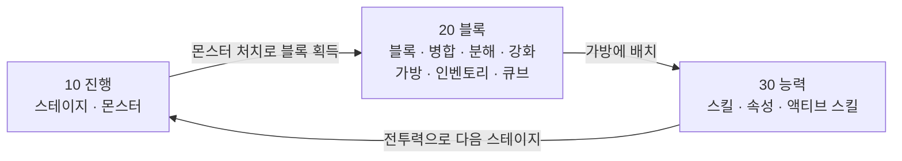

```table-of-contents
```
---
# 1. 게임 루프
- 기획 문서는 게임 루프의 세 단계로 나누어 정리합니다.


- `35 스탯`은 세 단계에서 조절하는 수치를 한곳에 모은 문서입니다. 테스트 중 값을 확인하고 고칠 때 봅니다.

# 2. 문서 목록
## 2-1. 00 개요
- [[PROJECT - P]]: 게임 소개, 핵심 가치
- [[📖 용어집]]: 기획 문서에서 정의한 용어 모음
## 2-2. 10 진행
- [[🏰 스테이지]]: 스테이지·라운드 구성, 몬스터 생성 규칙, 보스 보상, 블록 해금
- [[👿 몬스터]]: 몬스터 유형, 이동 방식, 생애 주기
## 2-3. 20 블록
- [[🧱 블록]]: 블록 정의, 블록 점수, 드롭 로직, 외형
- [[🧱 블록 병합]] / [[🧱 블록 분해]] / [[🧱 블록 강화]]
- [[📦 가방]]: 블록 배치 공간, 가방 레벨
- [[🎒 인벤토리]]: 블록 보관 공간, 확장
- [[💎 큐브]]: 블록 분해로 얻는 재화와 소모처
## 2-4. 30 능력
- [[⚔️ 스킬]]: 공격 스킬, 타격 우선순위
- [[⚡ 속성]]: 속성 종류와 효과
- [[✨ 액티브 스킬]]: 보스 보상으로 얻는 액티브 블록의 스킬
## 2-5. 35 스탯
- [[📊 몬스터 스탯]]: 몬스터 공유 스탯, 유형별 스탯, 상대 비교
- [[📊 플레이어 스탯]]: HP, 회복 증가, 방어력, 무적 시간
- [[📊 스킬 스탯]]: 모든 스킬의 공유 스탯, 탄환·광역 탄환·지형·지원의 개별 스탯
- [[📊 스킬 점수]]: 스킬 블록 점수에 따른 보너스
- [[📊 속성 스탯]]: 무속성 탄환, 속성 공유 스탯, 속성별 효과 수치
- [[📊 액티브 스킬 스탯]]: 회복·폭탄의 공유·개별 스탯
## 2-6. 40 데이터
- [[📑 데이터 테이블]]: 기획 문서에 적힌 CSV·데이터 파일 목록
- [[💬 시스템 메시지]]: 로케일 키와 문구 목록
## 2-7. 60 회의록 · 70 작업 관리
- [[2026-11-18]] / [[회의 안건]]
- [[🚧 작업 예정]] / [[🗺️ 개발 계획]]: 미정 사항 모아보기 / 구현 현황과 단계별 개발 계획

# 3. 문서 현황
- 시스템 문서의 frontmatter(`status`, `category`, `updated`)를 모아 보여줍니다.

```base
filters:
  and:
    - file.hasProperty("status")
views:
  - type: table
    name: 문서 현황
    order:
      - file.name
      - category
      - status
      - updated
```

# 4. 미정 사항
## 4-1. 작성 예정
```query
"[!TODO]" -path:_Templates -file:"문서 재구성 계획" -file:"🚧 작업 예정" -file:"🏠 Home"
```
## 4-2. 확인 필요
```query
"[!QUESTION]" -path:_Templates -file:"문서 재구성 계획" -file:"🚧 작업 예정" -file:"🏠 Home"
```
